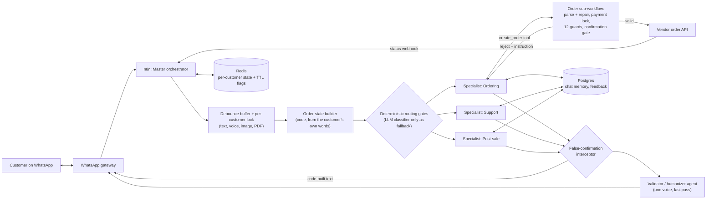

# Yasmin: AI Ordering Agent for WhatsApp

**English** · [Português (BR)](README.pt-BR.md)

> This is a case study and portfolio write-up. It documents the architecture of a production AI
> agent that takes food orders over WhatsApp, how it is evaluated, and the engineering problems
> solved while hardening it. The client's name, the vendor's name, phone numbers, customer data
> and credentials have been removed or genericized. The architecture, incidents, evidence,
> numbers and fixes are real. Last updated: October 2026.

**At a glance**

- **In production**, taking real orders: about **100 orders every two days**, with no human in the loop for the common case.
- **Multi-agent design:** a thin orchestrator with deterministic routing gates, **3 domain specialists** and a **final validator agent**. It runs as 16 n8n workflows with about 300 nodes. [See the topology](architecture/).
- **12 deterministic guards** sit between the LLM and the money, each one traced to a real incident ([code](guards/order-validation.js)). A second layer was added later: the order state is built by code, and a confirmation gate checks the order against what the customer actually said.
- **A regression bench of 1,492 cases** in 22 suites. It runs the real node code against a real menu snapshot. One suite was written from a single wrong order; the production code of that day passed **691 of its 894 cases**. [How it works](evals/).
- **An interceptor for false order confirmations.** It has caught one live ([code](guards/false-confirmation-interceptor.js)).
- **Undocumented vendor behaviour, reverse-engineered:** an internal field that made the model emit real-looking product IDs after two prompt fixes had failed, server-side price recalculation, and field names that are silently ignored.
- **A silent failure that had run for months, found by auditing every connection:** a branch that was never wired. That audit is now automated.
- **Credential and network failures tested against the real endpoints**, on isolated clones, without touching live service.

## What it does

A customer messages a restaurant's WhatsApp number by text or voice note. An AI agent ("Yasmin")
reads the menu, answers questions and builds an order: combos, swaps, add-ons, drinks, delivery
address, payment method and cash change. It then creates that order in the restaurant's
order-management system, with no human in the loop for the common case. It also pushes
delivery-status updates, handles changes to placed orders, and runs a post-order feedback flow.

This is not a chatbot demo. It moves real money and real food orders for real customers, and that
changes what "good enough" means. A hallucinated product ID, an unconfirmed choice, or a delivery
fee that silently falls back to the wrong zone is not a cosmetic bug. It is a wrong order or lost
revenue.

## Architecture



Three rules hold the whole system together:

**1. Thin orchestrator, specialist sub-workflows, one voice at the end.** The Master routes. Each
specialist owns one domain and its own tools, and a final validator agent rewrites every outgoing
message into one consistent voice. *Logic lives in the specialist, voice lives in the validator*,
so a tone change never risks breaking order logic, and the reverse holds too.

**2. Anything that touches money or makes a promise to the customer is deterministic code, never
a prompt.** Most of this write-up is about this rule. It was not a design principle at the start.
It was learned, expensively, from the failures below.

**3. State lives in code, not in the context window.** What the customer has ordered, what they
have already answered, and whether an order exists are all kept in Redis. Code writes them from
the customer's own messages and from the vendor's responses, and never from the model's account
of the conversation.

## How it is evaluated

The question that matters is not whether the reply sounds right. It is **which order reaches the
vendor, and whether it charges the right amount.** [Full write-up in `evals/`](evals/).

- **The bench runs the real code.** The Code nodes on the order path live as `.js` files, the same
  files pasted into n8n. The bench executes them in sequence, the way the sub-workflow does,
  against a vendor API simulated from a real menu snapshot.
- **The cases are two-sided.** *RIGHT* is what the customer asked for: the order must be created,
  with the exact total. *WRONG* is a mistake the model has been seen to make: the order must never
  be created wrong. Code either rejects it with an instruction or corrects it. The RIGHT side
  catches over-blocking, which a suite of bad inputs alone never would.
- **22 suites, 1,492 cases, all passing at the last run.** Nine legacy suites also run against both
  the previous and the current version. Any difference that is not on an allowlist of intended
  changes is reported as a regression.
- **Every failure is reproduced on the bench before it is fixed.** From 6 to 15 October, 28
  releases went through this loop: reproduce, fix, run every suite, apply, run one live test from
  a clean state, then check the vendor's panel rather than what the agent said.
- **The bench does not test the model.** It proves that the deterministic layer catches the
  model's mistakes. How often the model makes them is checked with scripted live conversations and
  by reading production orders against the panel. LLM tracing is planned but not live yet.

The most useful lesson from it: **the bench has to see what production sees.** A new lock passed
every test and then looped in production. The customer said "no" four times and was refused four
times, because production prepends a context line to the customer's message and the bench did
not. The node was fixed, and so was the bench. A harness that is cleaner than production gives a
false pass.

## Keeping an LLM honest in production

Prompt engineering gets an agent working in a demo. It does not reliably get an agent working when
real customers type messy, fragmented, ambiguous things at 11pm on a Friday.

The operating heuristic that came out of this project: **when a behaviour fails twice for the same
reason after a prompt fix, stop editing the prompt.** A second failure is evidence that the cause
is not in the prompt.

### 1. The model invented product IDs, and the reason was hiding in an undocumented field

Order creation started to fail intermittently with a generic `500` from the vendor API. The agent
was sometimes sending a numeric product ID, for a combo, that existed nowhere in the menu.

The lazy fix is to tell the model, harder, to use only real IDs. That had already been tried
twice, with no improvement.

The root cause was found by diffing the raw menu API response against what the agent actually
saw. For every add-on group, the vendor's menu endpoint returns an internal `product_id` used for
its own POS integration. That field is stripped before the agent sees it, but its numeric
*format* is identical to real, orderable product IDs. The model was generalizing the wrong numeric
pattern and sometimes landing on one of those internal IDs. They do exist in the vendor's system,
for something unrelated, so the API's validation did not reject them the way it rejects a made-up
number.

**Fix:** not a longer prompt. A guard re-fetches the live menu and validates every ID *before*
the order is submitted. It rejects with a structured error the agent can act on.

```js
const freshMenu = await this.helpers.httpRequest({ method: 'GET', url: menuEndpoint, headers, json: true });
const validGeneralIds = new Set(freshMenu.general.flatMap(cat => cat.products.map(p => Number(p.id))));
const validComboIds  = new Set(freshMenu.combos.map(c => Number(c.id)));

const invalidItem = orderItems.find(item => {
  const id = Number(item.id);
  return item.type === 'combo' ? !validComboIds.has(id) : !validGeneralIds.has(id);
});

if (invalidItem) {
  return [{ json: { error: 'order_creation_failed', detail: `invalid id ${invalidItem.id}` } }];
}
```

### 2. Requiring a field does not prove that the question was asked

Card payments have to be marked credit or debit. The tool schema required the field, and the
prompt told the agent to ask the customer before filling it in.

An order went out marked credit for a customer who had said "debit". The agent had never asked. It
filled the required field with a plausible value, because **a required field is a prompt for the
model, not proof of anything.** Requiring data does not make the question get asked.

**The fix that generalizes:** the value the model sends is *ignored entirely*. The method is
derived from the customer's own message, which reaches the workflow through a fixed mapping
instead of a model-populated argument, so the agent cannot forge it:

```js
const customerSaid = normalize(input.customerMessage);       // fixed mapping, not model-supplied
const saidCredit = customerSaid.includes('credito');
const saidDebit  = customerSaid.includes('debito');

if (!saidCredit && !saidDebit) {
  return reject('card payment without knowing credit or debit — the customer has not answered ' +
                'yet. Ask, WAIT for the reply, then call create_order again.');
}
payments.forEach(p => { if (p.paymentType === 'creditCard') p.cardPaymentMethod = saidDebit ? 'debit' : 'credit'; });
```

The principle behind it, which I now apply by default: **proof of a conversational event has to
be external to the model.** That means a flag written by the flow itself, or the customer's raw
message matched through a fixed mapping. It never means the model's own report that it asked.

The same pattern came back twice more. The agent created an order without ever asking
delivery-vs-pickup. Later it picked Pix as the payment method when nobody had mentioned payment.
Both are now guarded the same way. The flow writes a Redis key only when the outgoing message
actually contains the question, or when the customer stated the answer first, and order creation
refuses to go ahead without that key. On cash delivery, the change question must also have been
answered.

**A postscript, found later.** The guard derived the right value, but it wrote it to
`cardMethod`. The vendor reads `cardPaymentMethod`. The wrong key was accepted and ignored, so the
store's panel showed only "Card" and credit/debit never reached the store. It surfaced when the
vendor's support answered a written list of 21 questions about the API. The guard logic was right;
the field it wrote to was wrong. This is the same failure mode as the change field below.

### 3. The agent announced orders that were never created

Sometimes the agent told a customer "order confirmed!" when the order-creation tool had never
succeeded, or had never been called. The customer then waits for food no kitchen knows about,
which is worse than an error message.

**Fix:** an interceptor between the specialist and the customer cross-checks the outgoing text
against real state. Order creation writes a short-TTL key when, and only when, the vendor API
returns success. If the outgoing message announces an order and no order key exists, the message
is *replaced* before it is sent. It has caught a live one.
[The code is here](guards/false-confirmation-interceptor.js).

Two of its later changes came from its own failures:

- **A false positive.** A customer asked about their order three minutes after placing it. The
  short-TTL key had expired, so the interceptor replaced a correct answer with "your order was not
  registered", which was false. It now also accepts the two-hour active-order key. *A guard's false
  positives reach the customer too.*
- **The humanizer rewrote code-built text.** Order summaries and closing messages are built by code
  from the vendor's response. The validator agent was rewording them, so they now bypass it. When
  the model leaves out part of the closing message (the Pix payment details, or the drink
  question), the interceptor restores it from the create-order tool's own return value, read
  through the agent's intermediate steps.

### 4. Routing that depended on a classifier's guess

The post-order feedback poll offers Excellent / Good / Bad. Tapping **Bad** worked. Tapping
**Good** made the agent greet the customer as if the conversation had just started.

The root cause was in the conversation log. With no active-order flag and no pending-complaint
flag, the message fell through to an LLM classifier, which read the bare word "Good" as a
greeting. "Bad" *reads* like a complaint to a classifier; "Good" reads like "good morning". **The
routing of a real business event was resting on a model's guess about an ambiguous word.**

**Fix:** a deterministic exact-match gate ahead of the classifier. If the customer's whole message,
stripped of injected context lines and normalized, is exactly one of the three grades, it routes
to post-sale. "Good morning" and "sounds good" don't match; only the bare word that a button tap
produces does.

### 5. The order lived in the model's head

In one round of live tests, the agent lost an add-on in three orders out of four, even with a rule
in the prompt. "Bacon burger with salad and caramelized onion" plus "add extra bacon" came out with
only the bacon. "Two bacon" came out with one. It also asked again for things the customer had just
said, such as "pickup or delivery?" right after "deliver it to my house".

**Fix:** the order state moved out of the context window. On every message, code updates a
per-customer record in Redis from the customer's own words. It holds the add-ons mentioned and
their quantities (removed when the customer changes their mind), the payment method, the change,
and pickup or delivery. That record does two jobs:

- A code-built line at the top of the specialist's input tells it what the customer has already
  said and not to ask again.
- The confirmation gate (next section) checks the final order against it.

A conservative rule keeps it honest: a sentence that ends in "?" is a question, not an order, so
it does not count.

### 6. Every guard passed, and three orders were still wrong

On one day, three orders reached the kitchen wrong, and all three had passed every guard. In one
of them, a side of fries had become a full combo. Each ID was valid, each add-on was in the right
group, the payload was well formed. **The guards checked that the order was valid. Nothing checked
that it was what the customer asked for.**

**Fix:** a confirmation gate that compares the order the agent assembled with the customer's own
words, using the order state above:

- every item the customer named is in the order;
- no combo appears that the customer didn't ask for;
- each add-on sits on the item it was mentioned with, and "on both" or "on each" applies only to
  the items in that sentence;
- more than one of the same add-on is accepted only if a number was said.

Each rule came from a reproduced failure; the gate went through 28 versions in a month. When a
check fails, it rejects with the product and ID that are missing, so the agent can fix the order
without asking the customer again.

**Customer confirmation was not a safety net.** At first, the gate also showed the customer a
summary and asked "shall I send it to the kitchen?". On the day the redesigned flow went live, a
customer asked for two kids' combos. The menu has no item called "kids", the search returned every
combo, and the agent picked a different one. The customer read the summary and answered "yes". The
store had to step in by hand. The owner then asked for fewer questions and no review at the end.
The summary step was removed: an order that passes the gates is created immediately. The safety
moved from the customer's eyes into code, and that is exactly why the bench exists.

### 7. Context size was a bug

The menu tool used to return about 15,300 characters per call. That text was stored in memory and
replayed on every turn, so a conversation with two or three menu lookups carried about 30,000
characters of JSON. Those were the turns in which the agent forgot which step it was on and
repeated questions.

**Fix:** the tool now takes a search term, the product the customer named. It returns only the
matching products, or a compact one-line-per-product menu, with unavailable items removed. A search
word that matches nothing comes back as "not found", with an instruction to say so. The agent may
never substitute another product: the kids' combo order above happened because one word matched
everything.

## Reverse-engineering an undocumented vendor API

The public docs covered maybe half of what shipping this required. The rest came from support
tickets, controlled experiments, and reading what real orders recorded.

### The vendor recalculates the total, and the totals you send are ignored

The order payload has a `total` field and a `deliveryFee` field. Both are accepted, and both are
silently discarded. The vendor recomputes:

```
total         = sum of items, priced from THEIR catalog
totalNetValue = total + deliveryFee
deliveryFee   = the fee of the delivery zone referenced by deliveryFeeID
```

Two real orders established this, one field at a time:

| order | what we sent | what the vendor recorded |
|---|---|---|
| A | `total = 37` (32 items + 2 fee + 3 surcharge) | `total: 32, deliveryFee: 2, totalNetValue: 34` |
| B | `deliveryFee = 5` | `total: 29, deliveryFee: 2, totalNetValue: 31` |

Order A settled the `total` field and order B settled `deliveryFee`. The practical consequence is
sharp: **no field can carry a surcharge.** Money enters an order through exactly two doors, the
items or the zone record. Anything else is a number the vendor throws away, and a "working" fix
that silently charges the wrong amount is worse than a visible failure.

### A delivery surcharge with nowhere to live

Some outlying localities had to cost more than the default zone. As shown above, that means they
have to exist as zone records. At first, the vendor's zone form rejected their names: it is backed
by a geocoder that did not know these informal local names. The interim fix billed them through a
nearby neighbourhood the geocoder did know, with the real locality written in the order note for
the driver.

Once the real zones were registered, a second trap showed up. The fee lookup matches the
neighbourhood **by exact text, including case and accents, as stored in the vendor's panel.** With
one accent missing, the lookup returned `found: false` and the order fell back to the cheaper
default zone. Two real orders were undercharged that way. The fix tries the known spellings in
order. The fallback stays: if no spelling matches, the order still goes through at the default fee,
with an explicit manual-surcharge note for the store. **No order ever breaks because a pricing
lookup did.**

### Fields that are accepted and then ignored

Cash orders were reaching the kitchen with the change amount at zero, so drivers left without
knowing whether to bring change. The payload was sending `change` and `changeFor`. The field the
vendor actually reads is **`changeValue`, nested inside the payment object**, and the unrecognized
keys were accepted and ignored instead of rejected.

That was not the last one:

| what we sent | what actually happens |
|---|---|
| `change`, `changeFor` | ignored; the vendor reads `changeValue` inside the payment |
| `cardMethod` | ignored; the vendor reads `cardPaymentMethod` (see section 2) |
| `order_notes` | accepted, but **not shown on the store's panel and not printed on the kitchen ticket**; whatever the kitchen must see now goes in the first item's notes |
| `order_notes` over 180 characters | `400 Failed to register order`, with no hint that the length was the problem |
| an approval call on an order that is already approved | `200` with an error-shaped body; it is not an error and must not stop the flow |

This is the failure mode that makes undocumented APIs expensive: **a wrong field name doesn't
error, it quietly does nothing.** Every field in the payload is now either confirmed by a real
order's recorded output or marked as unverified in a comment. The vendor's support also confirmed
that there is no idempotency key. The flow's own `order_created` lock is the only thing that stops
one confirmation from creating two orders.

## The guard catalogue

Every guard exists because of a specific incident. The 12 guards below live in the
order-validation layer that runs before any order reaches the vendor.
**[The code is in `guards/`](guards/)**, redacted but structurally unmodified.

| Guard | What it blocks | The incident that created it |
|---|---|---|
| Delivery type has no default | Empty or invalid value | An order silently became counter pickup |
| `delivery_asked` flag required | Ordering without having asked delivery vs. pickup | An order created from a conversation in which it was never asked |
| `order_created` lock | Two orders from one confirmation | A double-charged customer |
| Item JSON shape (4 separate checks) | Malformed payload | Broken JSON reached the API as a generic 500 |
| JSON repair pass | One trailing brace | A single stray character killed a real order |
| Invalid item ID | ID outside the live menu | The undocumented-field story above |
| Add-on group mismatch | Add-on ID from another product's group | `400 Extra does not belong to combo` |
| Drink validation | A drink note that matches no available can | A combo shipped with a drink nobody chose |
| Payment type whitelist | Portuguese words, and one plausible but nonexistent card type | Three separate `400`s |
| Credit/debit from the customer's words | The model inventing the card method | The wrong method on a real order |
| Change amount sanity | "Needs change" with a value at or below the total | Change that cannot exist |
| False-confirmation interceptor | Announcing an order that was never created | Caught live |

**The second layer**, added after those guards stopped being enough, answers a different
question: *is this what the customer asked for?* rather than *is this a valid order?*

| Layer | What it adds |
|---|---|
| Order-state builder | The customer's choices, kept by code in Redis, so they are not lost from the context window |
| Confirmation gate | The order is compared with the customer's words: named items, combos, add-ons per item, quantities |
| Payment lock | The payment method, and the change on cash delivery, must have been stated by the customer |
| Menu search with "not found" | A product that doesn't exist is reported, never substituted |

The pattern worth taking from all of them: each one **rejects with an instruction, not an error
code.** The agent receives "the customer hasn't answered yet: ask, wait, then call again", which
it can act on, instead of a stack trace that it would paraphrase badly to the customer.

## Finding a silent failure by auditing, not guessing

The order-status lookup had apparently never worked for normal, non-cancelled orders, for as long
as anyone remembered. It was written off as vendor flakiness and worked around with retries and
human escalation.

The root cause was an `IF` node with two branches, "cancelled/scheduled" and "everything else".
Only the first was wired to anything. The second, which fires for the overwhelming majority of real
orders, connected to nothing, and the sub-workflow simply stopped without a sound.

It was found by re-reading every node's connections against what the tool was supposed to return,
because every other explanation had been ruled out with evidence. The fix was one missing
connection; the investigation was the work.

**The audit is now a tool.** A script turns the n8n export, the node code and the test bench into
one dependency graph. It shows which nodes read and write each Redis key, which node outputs each
expression reads, which sub-workflow each tool calls, and which test file covers which node. It
then lists candidate defects: wires to missing nodes, calls to workflows outside the export, keys
read but never written, keys written without an expiry, nodes with no input. On the latest export
it found no broken links, no key read without a writer and no key without an expiry. It flagged
three keys written but never read, all already known, and four disconnected nodes to review.

That work produced a rule the whole project runs on: **the signal that counts is external state.**
Not the agent saying it registered a complaint, but the row in the database. Not "order
confirmed", but the order in the vendor's panel. Agents report successes they did not achieve;
systems of record don't.

## Testing failure modes without touching production

Two tools depend on external APIs. I needed to know what happens when those calls really fail, not
what should happen in theory.

Corrupting the real credential to test this was rejected on purpose. That credential is shared
across the whole restaurant, so breaking it even briefly would degrade service for every real
customer messaging at that moment.

Instead, I built a complete clone of the production workflow on a different, private webhook path,
with the credential or target host swapped for one guaranteed to fail. It ran the same agent, the
same prompt and the same tool calls, with nothing shared with production.

- Invalid credential: a real `401` from the real endpoint, caught cleanly. The customer gets a
  normal response, with no stack trace and no silent hang.
- Unreachable host (a real TCP failure, not a mock): the same graceful handling.

## A platform quirk, found by isolation

Applying a large update to the always-on production workflow started to fail with a generic `500`
and an empty body.

Rather than guess, I changed one variable at a time. A byte-identical clone of the entire workflow,
pushed as a new *inactive* workflow, saved instantly. That ruled out payload size and node
complexity in one move. The only remaining difference was that the target workflow was active,
with its webhook live, at the moment of the write. Deactivating it before writing and reactivating
it afterwards fixed the problem completely, and that is now a hard rule for this workflow. It is
not documented anywhere public; it was found with a controlled experiment.

## Limitations and what I'd do differently

A case study that only lists wins isn't useful, so here are the weak spots:

- **The deterministic layer has grown large.** The confirmation gate is about 1,100 lines and the
  order parser about 2,100, mostly text matching against what the customer said. The next step is
  designed but not built: a structured cart, built by code on every message and priced from the
  menu, that the gate checks directly instead of re-reading the conversation.
- **The bench covers code, not the model.** Live tests are scripted and manual, run one at a time,
  and nothing runs in CI. LLM tracing (one trace per message, with gate rejections and the total
  said compared against the total created) is planned and not live.
- **Concurrency is audited but not finished.** A static audit confirmed that every piece of
  customer state is keyed per customer. It also listed open items around the per-customer lock and
  error handling in the orchestrator, which are next on the list.
- **Some things the agent says still lag behind the order.** After adding items, the agent's
  acknowledgment sometimes names only part of them while the order itself is complete and correct.
  This is known and tracked.
- **The vendor's tokens started out hardcoded** in workflow parameters instead of the platform's
  credential store. It worked, scoped to a dev environment, but it is the first thing I'd change.

## Stack

n8n (self-hosted orchestration, 16 workflows) · OpenAI `gpt-4.1-mini` agents with function
calling (3 specialists and a validator), an LLM classifier as a routing fallback, voice-note
transcription · Redis (per-customer state and TTL flags) · PostgreSQL (agent chat memory, feedback)
· vendor REST API and status webhooks · WhatsApp gateway webhooks · Node.js regression bench (no
dependencies) · a dependency-graph audit script (Python)

## Status

In production, handling about 100 real orders every two days, end to end: menu browsing, combos
with swaps and add-ons, delivery and pickup, cash, card and instant-transfer (Pix) payment
including change, zone-based delivery pricing, delivery-status notifications, changes to placed
orders, and post-order feedback collection.

---

**João Paulo Lomba**, AI Engineer & Full Stack Developer
[GitHub](https://github.com/joaolombabr) · [LinkedIn](https://www.linkedin.com/in/joaolombadev/)
