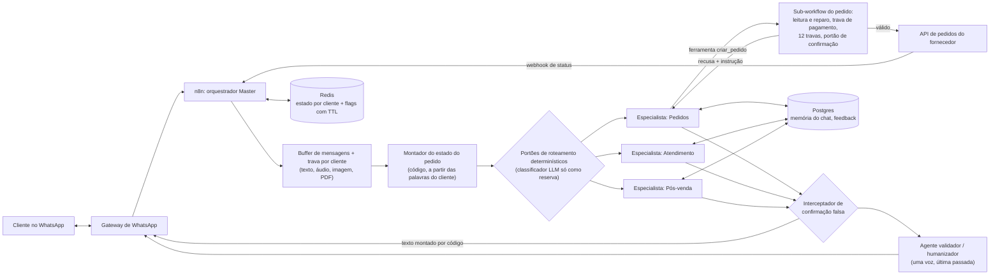

# Yasmin: agente de IA para pedidos pelo WhatsApp

[English](README.md) · **Português (BR)**

> Estudo de caso e portfólio. Este repositório documenta a arquitetura de um agente de IA em
> produção que recebe pedidos de comida pelo WhatsApp, como ele é avaliado e os problemas de
> engenharia resolvidos para deixá-lo confiável. O nome do cliente, o nome do fornecedor,
> telefones, dados de clientes e credenciais foram removidos ou generalizados. A arquitetura, os
> incidentes, as evidências, os números e as correções são reais. Atualizado em outubro de 2026.

**Resumo rápido**

- **Em produção**, recebendo pedidos reais: cerca de **100 pedidos a cada dois dias**, sem humano no meio no caso comum.
- **Desenho multiagente:** um orquestrador enxuto com portões de roteamento determinísticos, **3 especialistas de domínio** e um **agente validador final**. São 16 workflows n8n com cerca de 300 nós. [Veja a topologia](architecture/).
- **12 travas determinísticas** entre o LLM e o dinheiro, cada uma ligada a um incidente real ([código](guards/order-validation.js)). Depois veio uma segunda camada: o estado do pedido é montado por código, e um portão de confirmação confere o pedido contra o que o cliente realmente disse.
- **Uma bancada de regressão com 1.492 casos** em 22 baterias. Ela roda o código real dos nós contra um cardápio real. Uma das baterias nasceu de um único pedido errado; o código de produção daquele dia passava em **691 dos 894 casos**. [Como funciona](evals/).
- **Um interceptador de confirmações falsas de pedido.** Já pegou uma ao vivo ([código](guards/false-confirmation-interceptor.js)).
- **Comportamento não documentado do fornecedor, descoberto por engenharia reversa:** um campo interno que fazia o modelo gerar IDs de produto com cara de reais depois que duas correções de prompt falharam, o recálculo de preço no servidor e nomes de campo ignorados em silêncio.
- **Uma falha silenciosa que rodou por meses, achada auditando cada ligação:** um ramo que nunca foi conectado. Essa auditoria agora é automática.
- **Falhas de credencial e de rede testadas contra os endpoints reais**, em clones isolados, sem tocar o serviço ao vivo.

## O que ele faz

Um cliente manda mensagem para o WhatsApp de um restaurante, por texto ou áudio. Um agente de IA
("Yasmin") lê o cardápio, responde perguntas e monta o pedido: combos, trocas, adicionais,
bebidas, endereço de entrega, forma de pagamento e troco. Depois cria esse pedido no sistema de
gestão de pedidos do restaurante, sem humano no meio no caso comum. Ele também avisa o status da
entrega, trata alterações em pedidos já feitos e roda uma pesquisa de satisfação depois do pedido.

Não é uma demo de chatbot. Ele movimenta dinheiro de verdade e pedidos de comida de verdade para
clientes de verdade, e isso muda o que "bom o suficiente" significa. Um ID de produto alucinado,
uma escolha não confirmada ou uma taxa de entrega que cai calada na zona errada não é bug
cosmético. É pedido errado ou receita perdida.

## Arquitetura



Três regras seguram o sistema inteiro:

**1. Orquestrador enxuto, especialistas em sub-workflows, uma voz no final.** O Master roteia.
Cada especialista cuida de um domínio e das próprias ferramentas, e um agente validador final
reescreve toda mensagem de saída numa voz só. *A lógica fica no especialista, a voz fica no
validador*, então uma mudança de tom nunca arrisca quebrar a lógica do pedido, e o contrário
também vale.

**2. Tudo que toca dinheiro ou faz uma promessa ao cliente é código determinístico, nunca prompt.**
A maior parte deste texto é sobre essa regra. Ela não era um princípio de projeto no começo. Foi
aprendida, a um custo alto, com as falhas abaixo.

**3. O estado mora no código, não na janela de contexto.** O que o cliente pediu, o que ele já
respondeu e se o pedido existe ficam guardados no Redis. Quem grava é o código, a partir das
mensagens do cliente e das respostas do fornecedor, nunca a partir do relato do modelo sobre a
conversa.

## Como ele é avaliado

A pergunta que importa não é se a resposta soa certa. É **qual pedido chega ao fornecedor, e se
ele cobra o valor certo.** [Texto completo em `evals/`](evals/).

- **A bancada roda o código real.** Os nós Code do caminho do pedido ficam em arquivos `.js`, os
  mesmos que são colados no n8n. A bancada executa esses nós em sequência, como o sub-workflow
  faz, contra uma API do fornecedor simulada a partir de um cardápio real.
- **Os casos têm dois lados.** *CERTO* é o que o cliente pediu: o pedido tem que ser criado, com o
  total exato. *ERRADO* é um erro que o modelo já cometeu: o pedido nunca pode sair errado. O
  código recusa com uma instrução ou corrige. O lado CERTO pega o excesso de bloqueio, que uma
  bateria só de entradas ruins nunca pegaria.
- **22 baterias, 1.492 casos, todos passando na última rodada.** Nove baterias antigas também
  rodam contra a versão anterior e a atual. Qualquer diferença fora de uma lista de mudanças
  intencionais é apontada como regressão.
- **Toda falha é reproduzida na bancada antes de ser corrigida.** De 6 a 15 de outubro, 28
  entregas passaram por esse ciclo: reproduzir, corrigir, rodar todas as baterias, aplicar, fazer
  um teste ao vivo a partir de um estado limpo e conferir no painel do fornecedor, não no que o
  agente disse.
- **A bancada não testa o modelo.** Ela prova que a camada determinística pega os erros do
  modelo. A frequência desses erros é conferida com conversas roteirizadas ao vivo e lendo os
  pedidos de produção contra o painel. O rastreamento do LLM está planejado, ainda não está no ar.

A lição mais útil: **a bancada tem que ver o que a produção vê.** Uma trava nova passou em todos
os testes e entrou em laço em produção. O cliente disse "não" quatro vezes e foi recusado quatro
vezes, porque a produção põe uma linha de contexto na frente da mensagem do cliente e a bancada
não punha. O nó foi corrigido, e a bancada também. Uma bancada mais limpa que a produção dá um
falso positivo.

## Mantendo um LLM honesto em produção

Engenharia de prompt faz um agente funcionar numa demo. Ela não garante que o agente funcione
quando clientes de verdade escrevem coisas bagunçadas, picadas e ambíguas às 23h de uma sexta.

A regra de trabalho que saiu deste projeto: **quando um comportamento falha duas vezes pelo mesmo
motivo depois de uma correção de prompt, pare de mexer no prompt.** A segunda falha é evidência de
que a causa não está no prompt.

### 1. O modelo inventava IDs de produto, e o motivo estava num campo não documentado

A criação de pedidos começou a falhar de vez em quando com um `500` genérico da API do fornecedor.
Às vezes o agente mandava, para um combo, um ID numérico de produto que não existia em lugar
nenhum do cardápio.

A correção preguiçosa é mandar o modelo, com mais ênfase, usar só IDs reais. Isso já tinha sido
tentado duas vezes, sem melhora.

A causa raiz apareceu comparando a resposta crua da API do cardápio com o que o agente realmente
via. Para cada grupo de adicionais, o endpoint do cardápio devolve um `product_id` interno, usado
na integração com o PDV do próprio fornecedor. Esse campo é removido antes de chegar ao agente,
mas o *formato* numérico é idêntico ao dos IDs de produtos que podem ser pedidos. O modelo
generalizava o padrão numérico errado e às vezes caía num desses IDs internos. Eles existem no
sistema do fornecedor, para outra coisa, então a validação da API não os recusava como recusa um
número inventado.

**Correção:** não um prompt maior. Uma trava busca o cardápio ao vivo de novo e valida cada ID
*antes* de enviar o pedido. Ela recusa com um erro estruturado que o agente consegue usar.

```js
const freshMenu = await this.helpers.httpRequest({ method: 'GET', url: menuEndpoint, headers, json: true });
const validGeneralIds = new Set(freshMenu.general.flatMap(cat => cat.products.map(p => Number(p.id))));
const validComboIds  = new Set(freshMenu.combos.map(c => Number(c.id)));

const invalidItem = orderItems.find(item => {
  const id = Number(item.id);
  return item.type === 'combo' ? !validComboIds.has(id) : !validGeneralIds.has(id);
});

if (invalidItem) {
  return [{ json: { error: 'order_creation_failed', detail: `invalid id ${invalidItem.id}` } }];
}
```

### 2. Exigir um campo não prova que a pergunta foi feita

Pagamento no cartão precisa ser marcado como crédito ou débito. O schema da ferramenta exigia o
campo, e o prompt mandava o agente perguntar ao cliente antes de preenchê-lo.

Um pedido saiu como crédito para um cliente que tinha dito "débito". O agente nunca perguntou.
Preencheu o campo obrigatório com um valor plausível, porque **campo obrigatório é um pedido ao
modelo, não prova de nada.** Exigir o dado não faz a pergunta ser feita.

**A correção que generaliza:** o valor que o modelo manda é *ignorado por completo*. A forma é
tirada da própria mensagem do cliente, que chega ao workflow por um mapeamento fixo e não por um
argumento preenchido pelo modelo, então o agente não consegue forjá-la:

```js
const customerSaid = normalize(input.customerMessage);       // mapeamento fixo, não vem do modelo
const saidCredit = customerSaid.includes('credito');
const saidDebit  = customerSaid.includes('debito');

if (!saidCredit && !saidDebit) {
  return reject('card payment without knowing credit or debit — the customer has not answered ' +
                'yet. Ask, WAIT for the reply, then call create_order again.');
}
payments.forEach(p => { if (p.paymentType === 'creditCard') p.cardPaymentMethod = saidDebit ? 'debit' : 'credit'; });
```

O princípio por trás, que hoje aplico por padrão: **a prova de um evento da conversa tem que estar
fora do modelo.** Isso quer dizer uma flag gravada pelo próprio fluxo, ou a mensagem crua do
cliente lida por um mapeamento fixo. Nunca o relato do próprio modelo de que perguntou.

O mesmo padrão voltou mais duas vezes. O agente criou um pedido sem nunca perguntar entrega ou
retirada. Depois escolheu Pix como forma de pagamento sem ninguém ter falado de pagamento. As duas
hoje têm a mesma trava. O fluxo grava uma chave no Redis só quando a mensagem de saída realmente
contém a pergunta, ou quando o cliente já deu a resposta antes, e a criação do pedido não segue
sem essa chave. Na entrega em dinheiro, a pergunta do troco também tem que ter sido respondida.

**Um adendo, achado depois.** A trava chegava ao valor certo, mas gravava em `cardMethod`. O
fornecedor lê `cardPaymentMethod`. A chave errada era aceita e ignorada, então o painel da loja
mostrava só "Cartão" e crédito/débito nunca chegou à loja. Isso apareceu quando o suporte do
fornecedor respondeu uma lista escrita de 21 perguntas sobre a API. A lógica da trava estava
certa; o campo em que ela gravava estava errado. É a mesma falha do campo do troco, mais abaixo.

### 3. O agente anunciava pedidos que nunca foram criados

Às vezes o agente dizia ao cliente "pedido confirmado!" quando a ferramenta de criar pedido nunca
tinha dado certo, ou nem tinha sido chamada. O cliente fica esperando uma comida que nenhuma
cozinha conhece, o que é pior que uma mensagem de erro.

**Correção:** um interceptador entre o especialista e o cliente confere o texto de saída contra o
estado real. A criação do pedido grava uma chave de TTL curto quando, e só quando, a API do
fornecedor responde sucesso. Se a mensagem de saída anuncia um pedido e não existe chave de pedido,
a mensagem é *trocada* antes de ser enviada. Já pegou uma ao vivo.
[O código está aqui](guards/false-confirmation-interceptor.js).

Duas mudanças posteriores vieram das falhas dele mesmo:

- **Um falso positivo.** Um cliente perguntou do pedido três minutos depois de fazê-lo. A chave de
  TTL curto já tinha vencido, então o interceptador trocou uma resposta certa por "seu pedido não
  foi registrado", o que era falso. Agora ele também aceita a chave de pedido ativo, de duas horas.
  *Os falsos positivos de uma trava também chegam ao cliente.*
- **O humanizador reescrevia texto montado por código.** O resumo e o fechamento do pedido são
  montados por código a partir da resposta do fornecedor. O agente validador reescrevia esses
  textos, então agora eles passam direto. Quando o modelo deixa de fora parte do fechamento (os
  dados do Pix ou a pergunta da bebida), o interceptador repõe a partir do retorno da própria
  ferramenta de criar pedido, lido nos passos intermediários do agente.

### 4. Roteamento que dependia do palpite de um classificador

A pesquisa de satisfação depois do pedido oferece Ótimo / Bom / Ruim. Tocar em **Ruim**
funcionava. Tocar em **Bom** fazia o agente cumprimentar o cliente como se a conversa estivesse
começando.

A causa estava no log da conversa. Sem flag de pedido ativo e sem flag de reclamação pendente, a
mensagem caía num classificador LLM, que lia a palavra solta "Bom" como cumprimento. "Ruim" *soa*
como reclamação para um classificador; "Bom" soa como "bom dia". **O roteamento de um evento real
do negócio dependia do palpite de um modelo sobre uma palavra ambígua.**

**Correção:** um portão determinístico de correspondência exata antes do classificador. Se a
mensagem inteira do cliente, sem as linhas de contexto injetadas e normalizada, é exatamente uma
das três notas, ela vai para o pós-venda. "Bom dia" e "tá bom" não casam; só a palavra solta que o
toque no botão produz.

### 5. O pedido morava na cabeça do modelo

Numa rodada de testes ao vivo, o agente perdeu um adicional em três de quatro pedidos, mesmo com a
regra no prompt. "Bacon com salada e cebola caramelizada" mais "coloca bacon extra" saiu só com o
bacon. "Dois bacon" saiu com um. Ele também perguntava de novo o que o cliente tinha acabado de
dizer, como "vai retirar ou é entrega?" logo depois de "entrega na minha casa".

**Correção:** o estado do pedido saiu da janela de contexto. A cada mensagem, o código atualiza um
registro por cliente no Redis a partir das palavras do cliente. Ele guarda os adicionais citados e
as quantidades (tirados quando o cliente desiste), a forma de pagamento, o troco e se é entrega ou
retirada. Esse registro tem dois usos:

- Uma linha montada por código no topo da entrada do especialista diz o que o cliente já falou e
  que não é para perguntar de novo.
- O portão de confirmação (próxima seção) confere o pedido final contra ele.

Uma regra conservadora mantém o registro honesto: frase que termina em "?" é pergunta, não pedido,
e não conta.

### 6. Todas as travas passaram, e três pedidos saíram errados mesmo assim

Num mesmo dia, três pedidos chegaram errados na cozinha, e os três tinham passado por todas as
travas. Num deles, uma porção de batata tinha virado um combo inteiro. Todo ID era válido, todo
adicional estava no grupo certo, o payload estava bem formado. **As travas conferiam se o pedido
era válido. Nada conferia se era o que o cliente pediu.**

**Correção:** um portão de confirmação que compara o pedido montado pelo agente com as palavras do
cliente, usando o estado do pedido acima:

- todo item que o cliente citou pelo nome está no pedido;
- não aparece combo que o cliente não pediu;
- cada adicional fica no item junto do qual foi citado, e "nos dois" ou "em cada" vale só para os
  itens daquela frase;
- mais de um do mesmo adicional só passa se um número foi dito.

Cada regra veio de uma falha reproduzida; o portão passou por 28 versões em um mês. Quando uma
conferência falha, ele recusa dizendo o produto e o ID que faltam, para o agente corrigir o pedido
sem perguntar de novo ao cliente.

**A confirmação do cliente não era rede de segurança.** No começo, o portão também mostrava um
resumo ao cliente e perguntava "posso mandar pra cozinha?". No dia em que o fluxo redesenhado
entrou no ar, um cliente pediu dois combos kids. O cardápio não tem item chamado "kids", a busca
devolveu todos os combos e o agente escolheu outro. O cliente leu o resumo e respondeu "sim". A
loja teve que assumir na mão. A dona pediu então menos perguntas e nenhuma revisão no final. O
resumo saiu: pedido que passa nos portões é criado na hora. A segurança saiu dos olhos do cliente
e foi para o código, e é exatamente por isso que a bancada existe.

### 7. O tamanho do contexto era um bug

A ferramenta do cardápio devolvia cerca de 15.300 caracteres por chamada. Esse texto ficava na
memória e era repetido a cada turno, então uma conversa com duas ou três consultas carregava cerca
de 30.000 caracteres de JSON. Eram justamente esses os turnos em que o agente esquecia em que etapa
estava e repetia perguntas.

**Correção:** a ferramenta agora recebe um termo de busca, o produto que o cliente citou. Ela
devolve só os produtos que casam, ou um cardápio compacto com uma linha por produto, sem os
indisponíveis. Uma palavra da busca que não casa com nada volta como "não encontrado", com a
instrução de dizer isso ao cliente. O agente nunca pode trocar por outro produto: o pedido dos
combos kids acima aconteceu porque uma palavra casou com tudo.

## Engenharia reversa de uma API de fornecedor não documentada

A documentação pública cobria talvez metade do que foi preciso para colocar isto no ar. O resto
veio de chamados ao suporte, experimentos controlados e da leitura do que os pedidos reais
registravam.

### O fornecedor recalcula o total, e os totais que você manda são ignorados

O payload do pedido tem um campo `total` e um campo `deliveryFee`. Os dois são aceitos, e os dois
são descartados em silêncio. O fornecedor recalcula:

```
total         = soma dos itens, com os preços do catálogo DELES
totalNetValue = total + deliveryFee
deliveryFee   = a taxa da zona de entrega referenciada por deliveryFeeID
```

Dois pedidos reais provaram isso, um campo de cada vez:

| pedido | o que mandamos | o que o fornecedor registrou |
|---|---|---|
| A | `total = 37` (32 de itens + 2 de taxa + 3 de acréscimo) | `total: 32, deliveryFee: 2, totalNetValue: 34` |
| B | `deliveryFee = 5` | `total: 29, deliveryFee: 2, totalNetValue: 31` |

O pedido A resolveu o campo `total` e o pedido B resolveu o `deliveryFee`. A consequência prática é
dura: **nenhum campo carrega um acréscimo.** Dinheiro entra num pedido por exatamente duas portas,
os itens ou o cadastro da zona. Qualquer outra coisa é um número que o fornecedor joga fora, e uma
correção que "funciona" cobrando o valor errado em silêncio é pior que uma falha visível.

### Um acréscimo de entrega sem lugar para morar

Algumas localidades mais afastadas tinham que custar mais que a zona padrão. Pelo que está acima,
isso quer dizer que elas precisam existir como zonas cadastradas. No começo, o formulário de zonas
do fornecedor recusava esses nomes: ele depende de um geocodificador que não conhecia esses nomes
locais informais. A solução provisória cobrava por um bairro vizinho que o geocodificador conhecia,
com a localidade real escrita na observação do pedido para o entregador.

Quando as zonas reais foram cadastradas, apareceu uma segunda armadilha. A consulta da taxa compara
o bairro **pelo texto exato, incluindo maiúsculas e acentos, como está gravado no painel do
fornecedor.** Com um acento a menos, a consulta voltava `found: false` e o pedido caía na zona
padrão, mais barata. Dois pedidos reais foram cobrados a menos assim. A correção tenta as grafias
conhecidas em ordem. A reserva continua: se nenhuma grafia casar, o pedido segue com a taxa padrão
e uma observação explícita de acréscimo manual para a loja. **Nenhum pedido quebra porque uma
consulta de preço quebrou.**

### Campos aceitos e depois ignorados

Pedidos em dinheiro chegavam à cozinha com o troco zerado, e os entregadores saíam sem saber se
precisavam levar troco. O payload mandava `change` e `changeFor`. O campo que o fornecedor
realmente lê é **`changeValue`, dentro do objeto de pagamento**, e as chaves não reconhecidas eram
aceitas e ignoradas em vez de recusadas.

Não foi o último:

| o que mandamos | o que acontece de verdade |
|---|---|
| `change`, `changeFor` | ignorados; o fornecedor lê `changeValue` dentro do pagamento |
| `cardMethod` | ignorado; o fornecedor lê `cardPaymentMethod` (ver a seção 2) |
| `order_notes` | aceito, mas **não aparece no painel da loja e não imprime na comanda**; o que a cozinha precisa ver agora vai na observação do primeiro item |
| `order_notes` com mais de 180 caracteres | `400 Failed to register order`, sem nenhuma pista de que o problema era o tamanho |
| aprovar um pedido que já está aprovado | `200` com um corpo com cara de erro; não é erro e não pode parar o fluxo |

Essa é a falha que torna caras as APIs não documentadas: **um nome de campo errado não dá erro,
ele só não faz nada, calado.** Todo campo do payload hoje é confirmado pelo que um pedido real
registrou ou fica marcado como não verificado num comentário. O suporte do fornecedor também
confirmou que não existe chave de idempotência. A trava `order_created` do próprio fluxo é a única
coisa que impede uma confirmação de criar dois pedidos.

## O catálogo de travas

Toda trava existe por causa de um incidente específico. As 12 travas abaixo ficam na camada de
validação do pedido, que roda antes de qualquer pedido chegar ao fornecedor.
**[O código está em `guards/`](guards/)**, com dados retirados mas a estrutura sem alteração.

| Trava | O que bloqueia | O incidente que a criou |
|---|---|---|
| Tipo de entrega sem valor padrão | Valor vazio ou inválido | Um pedido virou retirada no balcão sem ninguém perceber |
| Flag `delivery_asked` obrigatória | Pedir sem ter perguntado entrega ou retirada | Pedido criado numa conversa em que isso nunca foi perguntado |
| Trava `order_created` | Dois pedidos para uma confirmação | Cliente cobrado em dobro |
| Formato do JSON dos itens (4 verificações) | Payload malformado | JSON quebrado chegou à API como um 500 genérico |
| Reparo de JSON | Uma chave sobrando no final | Um único caractere a mais derrubou um pedido real |
| ID de item inválido | ID fora do cardápio ao vivo | A história do campo não documentado, acima |
| Adicional de outro grupo | ID de adicional do grupo de outro produto | `400 Extra does not belong to combo` |
| Validação da bebida | Observação de bebida que não casa com nenhuma lata disponível | Um combo saiu com uma bebida que ninguém escolheu |
| Lista permitida de pagamento | Palavras em português e um tipo de cartão plausível mas inexistente | Três `400` diferentes |
| Crédito/débito pelas palavras do cliente | O modelo inventando a forma do cartão | Forma errada num pedido real |
| Troco que faz sentido | "Precisa de troco" com valor igual ou menor que o total | Troco que não pode existir |
| Interceptador de confirmação falsa | Anunciar um pedido que nunca foi criado | Pegou um ao vivo |

**A segunda camada**, criada quando essas travas deixaram de bastar, responde a outra pergunta:
*é isto que o cliente pediu?*, e não *este pedido é válido?*

| Camada | O que acrescenta |
|---|---|
| Montador do estado do pedido | As escolhas do cliente, guardadas por código no Redis, para não se perderem da janela de contexto |
| Portão de confirmação | O pedido é comparado com as palavras do cliente: itens citados, combos, adicionais por item, quantidades |
| Trava de pagamento | A forma de pagamento, e o troco na entrega em dinheiro, têm que ter sido ditos pelo cliente |
| Busca no cardápio com "não encontrado" | Produto que não existe é avisado, nunca trocado por outro |

O padrão que vale levar de todas elas: cada uma **recusa com uma instrução, não com um código de
erro.** O agente recebe "o cliente ainda não respondeu: pergunte, espere e chame de novo", que ele
consegue cumprir, em vez de um stack trace que ele repassaria mal ao cliente.

## Achando uma falha silenciosa auditando, não chutando

A consulta de status do pedido aparentemente nunca tinha funcionado para pedidos normais, não
cancelados, desde que alguém se lembrava. Isso era atribuído à instabilidade do fornecedor e
contornado com novas tentativas e escalada para humano.

A causa raiz era um nó `IF` com dois ramos, "cancelado/agendado" e "todo o resto". Só o primeiro
estava ligado a alguma coisa. O segundo, que dispara para a grande maioria dos pedidos reais, não
estava ligado a nada, e o sub-workflow simplesmente parava, sem nenhum aviso.

Ela foi achada relendo as ligações de cada nó contra o que a ferramenta deveria devolver, porque
todas as outras explicações já tinham sido descartadas com evidência. A correção foi uma ligação
que faltava; a investigação foi o trabalho.

**A auditoria agora é uma ferramenta.** Um script transforma o export do n8n, o código dos nós e a
bancada de testes num único grafo de dependências. Ele mostra quais nós leem e gravam cada chave do
Redis, qual saída de nó cada expressão lê, qual sub-workflow cada ferramenta chama e qual arquivo de
teste cobre qual nó. Depois lista os candidatos a defeito: ligação para nó que não existe, chamada a
workflow fora do export, chave lida e nunca gravada, chave gravada sem expiração, nó sem entrada.
No export mais recente ele não achou ligação quebrada, nem chave lida sem quem a grave, nem chave
sem expiração. Apontou três chaves gravadas e nunca lidas, todas já conhecidas, e quatro nós
desconectados para revisar.

Esse trabalho gerou uma regra que o projeto inteiro segue: **o sinal que conta é o estado
externo.** Não o agente dizendo que registrou a reclamação, mas a linha no banco de dados. Não
"pedido confirmado", mas o pedido no painel do fornecedor. Agentes relatam sucessos que não
alcançaram; sistemas de registro não.

## Testando falhas sem tocar a produção

Duas ferramentas dependem de APIs externas. Eu precisava saber o que acontece quando essas chamadas
falham de verdade, não o que deveria acontecer na teoria.

Estragar a credencial real para testar isso foi descartado de propósito. Ela é compartilhada pelo
restaurante inteiro, então quebrá-la, mesmo por pouco tempo, prejudicaria todo cliente real que
estivesse mandando mensagem naquele momento.

Em vez disso, montei um clone completo do workflow de produção num caminho de webhook diferente e
privado, com a credencial ou o host de destino trocados por um que com certeza falha. Rodava o mesmo
agente, o mesmo prompt e as mesmas chamadas de ferramenta, sem nada em comum com a produção.

- Credencial inválida: um `401` real do endpoint real, tratado direito. O cliente recebe uma
  resposta normal, sem stack trace e sem travar calado.
- Host inalcançável (falha TCP real, não um mock): o mesmo tratamento.

## Uma peculiaridade da plataforma, achada por isolamento

Aplicar uma atualização grande no workflow de produção, sempre ligado, começou a falhar com um
`500` genérico e o corpo vazio.

Em vez de chutar, mudei uma variável por vez. Um clone idêntico, byte a byte, do workflow inteiro,
enviado como um workflow novo e *inativo*, salvou na hora. Isso descartou de uma vez o tamanho do
payload e a complexidade dos nós. A única diferença que sobrou era que o workflow de destino estava
ativo, com o webhook no ar, no momento da gravação. Desativar antes de gravar e reativar depois
resolveu por completo, e virou regra fixa para este workflow. Isso não está documentado em lugar
público; foi achado com um experimento controlado.

## Limitações e o que eu faria diferente

Um estudo de caso que só lista vitórias não ajuda, então aqui estão os pontos fracos:

- **A camada determinística cresceu muito.** O portão de confirmação tem cerca de 1.100 linhas e o
  leitor do pedido cerca de 2.100, a maior parte comparando texto com o que o cliente disse. O
  próximo passo está desenhado, mas não construído: um carrinho estruturado, montado por código a
  cada mensagem e com os preços do cardápio, que o portão confere direto em vez de reler a conversa.
- **A bancada cobre o código, não o modelo.** Os testes ao vivo são roteirizados e manuais, feitos
  um por vez, e nada roda em CI. O rastreamento do LLM (um trace por mensagem, com as recusas do
  portão e o total dito comparado ao total criado) está planejado e não está no ar.
- **A concorrência foi auditada, mas não está fechada.** Uma auditoria estática confirmou que todo
  dado de cliente é guardado por cliente. Ela também listou pontos em aberto na trava por cliente e
  no tratamento de erros do orquestrador, que são os próximos da fila.
- **Parte do que o agente fala ainda fica atrás do pedido.** Depois de adicionar itens, a
  confirmação do agente às vezes cita só parte deles, enquanto o pedido em si está completo e
  certo. É conhecido e está sendo acompanhado.
- **Os tokens do fornecedor nasceram fixos no código**, em parâmetros do workflow, em vez de no
  cofre de credenciais da plataforma. Funcionou, restrito a um ambiente de desenvolvimento, mas é a
  primeira coisa que eu mudaria.

## Stack

n8n (orquestração self-hosted, 16 workflows) · agentes OpenAI `gpt-4.1-mini` com function calling
(3 especialistas e um validador), um classificador LLM como reserva do roteamento, transcrição de
áudio · Redis (estado por cliente e flags com TTL) · PostgreSQL (memória do chat dos agentes,
feedback) · API REST e webhooks de status do fornecedor · webhooks de um gateway de WhatsApp ·
bancada de regressão em Node.js (sem dependências) · script de auditoria por grafo de dependências
(Python)

## Situação

Em produção, com cerca de 100 pedidos reais a cada dois dias, de ponta a ponta: consulta ao
cardápio, combos com trocas e adicionais, entrega e retirada, pagamento em dinheiro, cartão e Pix
com troco, taxa de entrega por zona, avisos de status da entrega, alterações em pedidos feitos e
pesquisa de satisfação depois do pedido.

---

**João Paulo Lomba**, AI Engineer & Full Stack Developer
[GitHub](https://github.com/joaolombabr) · [LinkedIn](https://www.linkedin.com/in/joaolombadev/)
